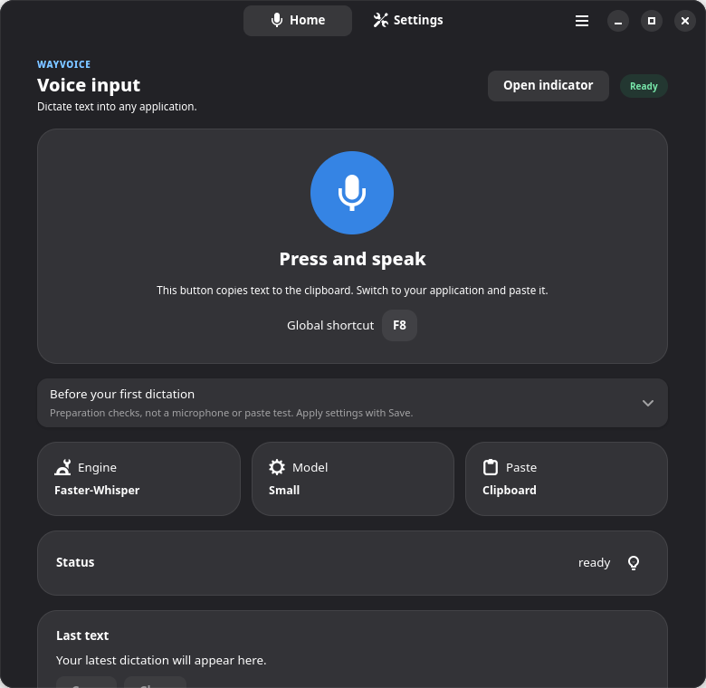

<p align="center">
  
</p>

# WayVoice

**Private, offline voice typing for Linux.** Press a shortcut. Speak. Keep typing.

[](https://github.com/pavlenkosa/wayvoice/actions/workflows/ci.yml)
[](LICENSE)


[Download](https://github.com/pavlenkosa/wayvoice/releases) · [Getting started](docs/getting-started.md) · [Changelog](CHANGELOG.md) · [Get help](SUPPORT.md)



Real English interface shown with an isolated demo state, without personal dictation. [Settings](data/screenshots/settings-en.png) · [First launch](data/screenshots/setup-en.png)

## Install

Open [GitHub Releases](https://github.com/pavlenkosa/wayvoice/releases), choose a release and download a package listed in its assets. Verify it against that release's `SHA256SUMS`. Alpha releases are marked **Pre-release** and are installed manually; the native updater follows stable releases only.

```bash
# Debian / Ubuntu
sudo apt install ./wayvoice_*_amd64.deb

# Fedora 44
sudo dnf install ./wayvoice-*-1.fc44.x86_64.rpm
```

Open **WayVoice**, explicitly prepare a model, and configure your shortcut. Initial runtime/model preparation needs a network connection; recognition with prepared local models works offline. Missing models are never downloaded by pressing the dictation shortcut.

The release workflow builds experimental x86_64 Flatpak bundles. Use one when it is listed in the chosen release's assets; installed sandbox dictation still needs testing. WayVoice is not on Flathub. See [installation and manual updates](docs/installation.md), including the separate GNOME Platform 50 dependency.

## Features

- Local Faster-Whisper and whisper.cpp recognition; optional warm recognizer.
- Wayland clipboard delivery and optional automatic paste. If insertion is unavailable, text stays in the clipboard.
- Explicit model preparation with progress, cancellation and storage controls; quick prepared model/language selection on Home.
- Microphone selection, optional recording sounds, personal text replacements and a compact status indicator.
- Ten offline interface languages: English, Russian, Spanish, Portuguese, French, German, Simplified Chinese, Japanese, Arabic and Hindi.
- Automatic speech-language detection or fixed language with compatible models. See [all 100 recognition language choices and model limitations](docs/engines-and-models.md#supported-languages).

## Desktop support

**Alpha:** automated tests do not establish complete desktop support.

| Environment | Current scope |
| --- | --- |
| GNOME / Wayland | Primary tested desktop |
| KDE Plasma / Wayland | Shortcut integration implemented; complete installed dictation/paste acceptance pending |
| wlroots | Community testing needed |
| Flatpak | Bundle build verified; installed sandbox acceptance pending |

Automatic paste depends on permissions and optional `ydotool`; manual clipboard paste remains available. GNOME shortcuts toggle recording; portal hold-to-talk currently targets KDE. [Desktop compatibility](docs/desktop-support.md) · [Shortcuts and paste](docs/shortcuts-and-paste.md)

## Documentation

[Installation and updates](docs/installation.md) · [Getting started and CLI](docs/getting-started.md) · [Engines, models and languages](docs/engines-and-models.md) · [Troubleshooting and privacy](docs/troubleshooting.md)

For contributors: [Contributing](CONTRIBUTING.md) · [Development](docs/development.md) · [Architecture](docs/architecture.md) · [Release process](docs/releasing.md) · [Security](SECURITY.md)

Bug reports, translations and desktop testing are welcome. Review diagnostics and remove private dictation before sharing them.

## License

[GNU Affero General Public License v3.0 or later](LICENSE). Bundled helper licensing is listed in [third_party/ydotool](third_party/ydotool/README.wayvoice.md).
